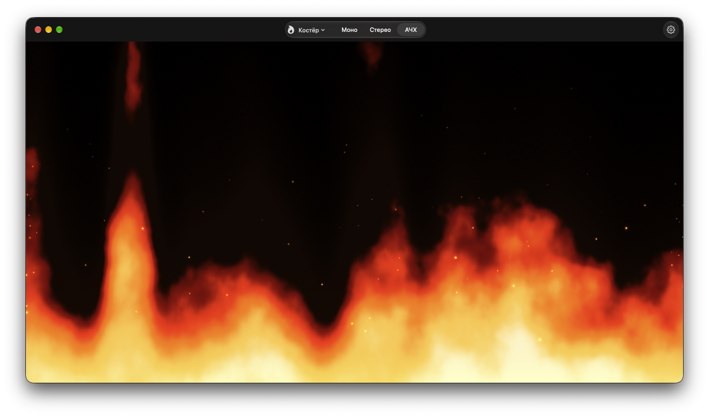
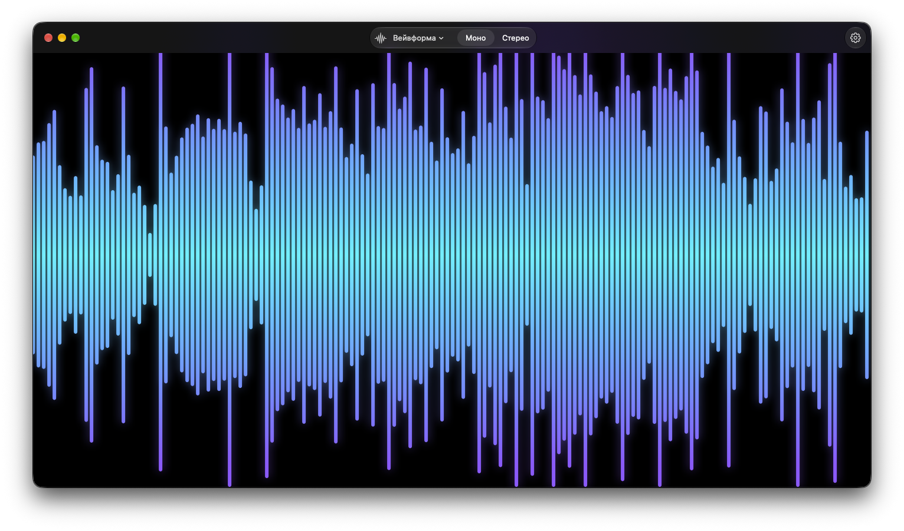
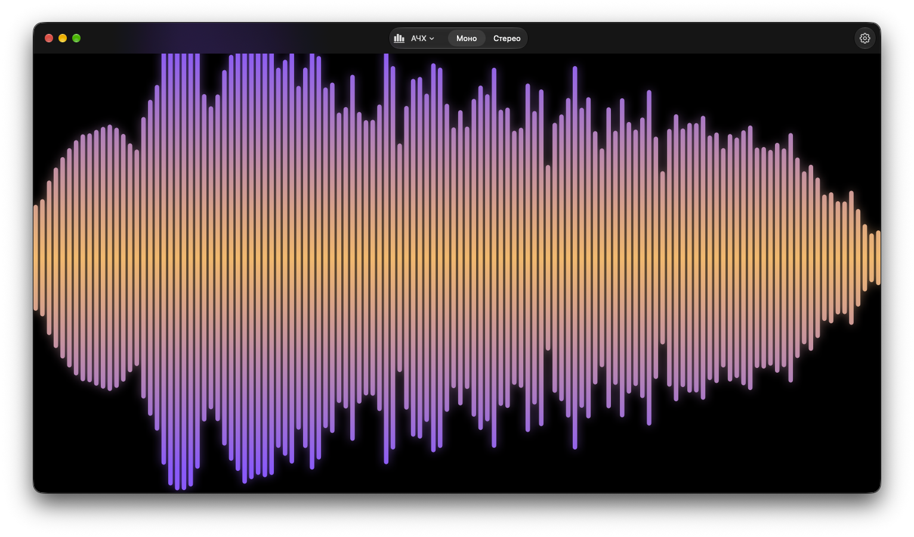
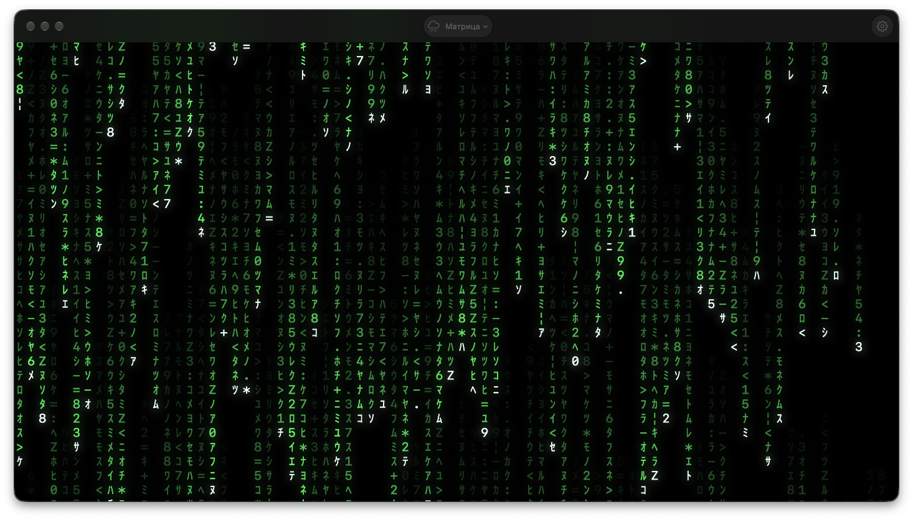

<p align="center">
  
</p>

<h1 align="center">Audio Visualizer</h1>

<p align="center">
  A macOS audio visualizer that reacts to whatever your Mac is playing —<br>
  music, video, calls — with no microphone and no audio-device setup.
</p>



> The app's interface is in Russian; the names in parentheses below are what you'll see in it.

## Modes

| | |
|---|---|
| **Campfire** (Костёр) — fire across the full width of the window. Tongue heights are random with a normal distribution, and now and then a single tongue flares up; loudness raises the whole fire. |  |
| **Waveform** (Вейвформа) — the loudness envelope of the last few seconds, scrolling from right to left. The level adapts to the track, so you see the beats instead of a solid wall. |  |
| **Spectrum** (АЧХ) — bass on the left, treble on the right (30 Hz – 16 kHz, log scale). |  |
| **Matrix** (Матрица) — digital rain. Each column is a frequency band: the louder the band, the more often, longer and faster streams of glyphs fall from the top. |  |

### Submodes

| Mode | Submodes |
|---|---|
| Campfire | **Mono** — the whole fire follows the overall loudness · **Stereo** — the left half follows the left channel, the right half the right one · **Spectrum** — bass lights the left of the fire, treble the right |
| Waveform, Spectrum | **Mono** · **Stereo** — left channel above the centre line, right channel below |
| Matrix | spectrum only |

Switch the mode and submode in the window's header.

## Full screen

In full screen the header is hidden so nothing gets in the way of the picture. The controls live in a sidebar at the **left edge**: move the pointer there and it slides in, with the window buttons, the list of modes and submodes, and Settings. A hint about it appears when you enter full screen (you can turn it off in Settings).

## Settings

Open with <kbd>⌘</kbd> <kbd>,</kbd> or the gear in the header. Settings are grouped per mode:

- **General** — sensitivity to sound, the full-screen hint.
- **Campfire** — the bell shape across the width, tongue width, height spread, how often tongues flare up, sparks, submode.
- **Waveform** — history length, bar width, loudness range, fading of the past, submode, colours.
- **Spectrum** — bar width, loudness range, fall smoothness, submode, colours.
- **Matrix** — glyph size, speed, frequency of new glyphs, trail length, loudness range.

Bar colours are either a **gradient** between two colours you pick (from the centre line to the bar ends, with a separate pair for the right channel in stereo) or a **spectrum** — a rainbow across the width.

Each group has a Reset button, and all settings persist between launches.

## Requirements

- macOS 27.2 or later
- Xcode 27 to build

On first launch macOS asks for permission to **record system audio** — without it the visualization won't react to sound. If you declined, turn it on in System Settings → Privacy & Security.

## Building

```bash
git clone https://github.com/1mbryk/Audio-Visualizer.git
cd Audio-Visualizer
open "Audio Vusualizer.xcodeproj"
```

Then press <kbd>⌘</kbd> <kbd>R</kbd> in Xcode. Or from the terminal:

```bash
xcodebuild -project "Audio Vusualizer.xcodeproj" -scheme "Audio Vusualizer" -configuration Release build
```

## How it works

- **Audio capture** — a Core Audio process tap (`CATapDescription`) captures system audio without any virtual audio device, while the sound keeps playing through your speakers.
- **Analysis** — per-channel loudness (RMS), peak and energy history for the waveform, and a 4096-sample FFT (Accelerate) grouped into log-spaced bands with automatic levelling.
- **Rendering** — SwiftUI. The fire and the matrix are Metal shaders (fractal noise for the fire, a glyph atlas for the matrix); the bars are drawn with `Canvas`.

| File | Contents |
|---|---|
| `SystemAudioMonitor.swift` | system audio capture, levels, sample and peak history |
| `SpectrumAnalyzer.swift` | FFT and frequency bands |
| `Fire.metal` | fire and digital-rain shaders |
| `CampfireView.swift`, `FireModel.swift` | Campfire mode |
| `WaveformView.swift` | Waveform mode |
| `SpectrumView.swift`, `MirroredBars.swift`, `BarPalette.swift` | Spectrum mode and the shared bars with their colours |
| `MatrixView.swift` | Matrix mode |
| `ContentView.swift` | window, header, full-screen sidebar |
| `SettingsView.swift` | settings window |
